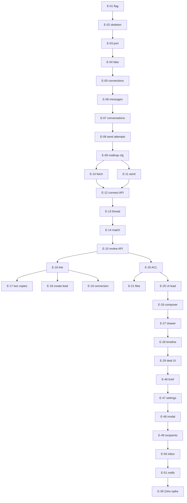

# CRM Email — implementation checklist

**Docs:** [README](./README.md) · [brief](./brief.md) · [architecture](./architecture.md) · [dependencies](./dependencies.md) · [access-matrix](./access-matrix.md)  
**PRD:** CRM-COM-EMAIL v0.2

Do **not** start E-01 until explicitly asked. One task per change-set unless the prompt says otherwise.

---

## How to run tasks

| Mode | Prompt |
|------|--------|
| **Implement** | `Implement task E-XX from docs/email/checklist.md. Read docs/email/architecture.md first. Flag crm.email; fail closed if off. New Email module only — do not use communication_activities, company SMTP, ticket IMAP, or Zoho calendar tokens. Mailbox copy is SOT. MailTransport port only. Done when the task acceptance checks pass. Do not start the next task.` |
| **Verify** | `Verify task E-XX from docs/email/checklist.md. Do not expand scope.` |

**Status:** `todo` · `doing` · `done` · `blocked (reason)`

**Default order:** E-01 → E-08, then E-09–E-12 (M1), E-13–E-19 (M2), **E-20 before any UI that shows bodies**, E-25–E-29 (M3), E-30–E-37 (M4), E-38 (Zoho OAuth, done), **E-46–E-51 (communication surfaces) before E-39–E-41**, E-42–E-45 (policy).

**Milestones:** M1 = E-12 · M2 = E-19 · M3 = E-29 · M4 = E-37 · M6 = E-51 · M5 = E-41 + policy (E-39–E-41 wait on E-48–E-51).

---

## A. Scaffold

### Task E-01 — Feature flag

| | |
|--|--|
| **Goal** | `crm.email` is a known flag, off by default, testable. |
| **Depends on** | None |
| **Files** | `config/features.php`, `app/Support/FeatureFlags.php` or a small `App\Email` helper, tests under `tests/Feature/Email/` |

#### Impl

1. Add `'crm.email'` to `known_flags`.
2. Do **not** set it true in `local_defaults`.
3. Helper `EmailFeature::enabled()` wrapping `FeatureFlags::enabled('crm.email')`.
4. PHPUnit: flag off by default in tests; `SetsFeatureFlags` can turn it on.

#### Out of scope

Routes, UI, Mailtrap, registering the flag in the remote flags service (ops; note in PR).

#### Verify

- [x] `forInertia()` includes `crm.email`
- [x] Flag absent/false → helper false
- [x] Test override true → helper true

---

### Task E-02 — Module skeleton

| | |
|--|--|
| **Goal** | Empty `App\Email` (+ JS folder) and `config/email.php` exist; nothing callable in production. |

#### Impl

1. `app/Email/` PSR-4 (composer autoload if needed).
2. `config/email.php`: flag name, queue names `email-sync` / `email-send`, default provider `fake`.
3. `resources/js/Pages/Email/` or `resources/js/Email/` placeholder only if required; prefer no UI yet.
4. No public routes.

#### Out of scope

Port implementation, migrations.

#### Verify

- [x] `config('email.queues.sync')` etc. resolve
- [x] App boots; no new endpoints

---

### Task E-03 — Port and DTOs

| | |
|--|--|
| **Depends on** | E-02 |

#### Impl

1. `MailTransport` interface per [architecture.md](./architecture.md).
2. DTOs: `NormalizedMessage`, `SendResult`, `Checkpoint`, `FetchPage`, `Draft`.
3. Value objects for addresses; RFC ids as strings.

#### Out of scope

HTTP, Mailtrap SDK.

#### Verify

- [x] Interface compilable; DTOs have no Eloquent

---

### Task E-04 — Fake adapter

| | |
|--|--|
| **Depends on** | E-03 |

#### Impl

1. `FakeMailAdapter`: in-memory store per connection key.
2. Seed helpers: inbound, outbound, **same Message-ID on two connections**, send accept / reject / timeout / throttle.
3. Bind in `testing` (and local default).

#### Verify

- [x] Unit tests cover seed + fetch + send results without network

---

## B. Persistence

### Task E-05 — Connections and allowlist

| | |
|--|--|
| **Depends on** | E-01, E-02 |

#### Impl

1. Migrations: `email_connections`, `email_pilot_allowlist`.
2. Encrypted `credentials` cast; never plaintext IMAP-style.
3. Factories; company scope.

#### Out of scope

OAuth, UI.

#### Verify

- [x] Encrypt round-trip
- [x] Company isolation on the model

---

### Task E-06 — Messages and mailbox copies

| | |
|--|--|
| **Depends on** | E-05 |

#### Impl

1. `email_messages`, `email_mailbox_copies` as in architecture.
2. Unique (`connection_id`, `provider_message_id`); canonical dedupe on company + RFC Message-ID when present.
3. Service: `ingestNormalized(Connection, NormalizedMessage): Copy` idempotent.

#### Verify

- [x] Double ingest same provider id → one copy
- [x] Same RFC id, two connections → one message, two copies

---

### Task E-07 — Conversations and record links

| | |
|--|--|
| **Depends on** | E-06 |

#### Impl

1. `email_conversations`, `email_record_links`, `email_link_audits`.
2. Link/unlink APIs as domain methods (no HTTP yet if easier — HTTP in E-16).
3. Unlink: delete/disable links; copies remain.

#### Verify

- [x] Unlink leaves copies; audit row written

---

### Task E-08 — Send attempts

| | |
|--|--|
| **Depends on** | E-05 |

#### Impl

1. `email_send_attempts`, `email_send_recipients`.
2. Statuses: `sending`, `sent`, `failed`, `checking`, `waiting_quota`. **No** `delivered`.
3. Retry uses the same attempt id.

#### Verify

- [x] Accept → `sent` not `delivered`
- [x] Second retry does not create a second attempt when reconciling unknown

---

## C. Mailtrap (M1)

### Task E-09 — Mailtrap config

| | |
|--|--|
| **Depends on** | E-03, E-05 |
| **Blocked on** | Token in env for **manual** verify only; tests must not need live Mailtrap |

#### Impl

1. Config/env keys per [dependencies.md](./dependencies.md).
2. `MailtrapAdapter` scaffolding: map connection credentials → API client.
3. Document two-sandbox mapping in `config/email.php` comments.

#### Verify

- [x] Missing token → health = needs_reconnect, no exception leak

---

### Task E-10 — Mailtrap fetch + sync job

| | |
|--|--|
| **Depends on** | E-04, E-06, E-09 |

#### Impl

1. `fetchSince` → ingest.
2. Job on `email-sync`; skip if flag off, not allowlisted, or `stopped`.
3. Exclude empty/error inboxes cleanly; checkpoint persist.

#### Out of scope

Folder policy beyond what sandbox returns; bounce.

#### Verify

- [x] Fake path: job ingests fixture
- [ ] Optional manual: one sandbox message → one copy locally
- [x] Job no-ops when flag off

---

### Task E-11 — Mailtrap send

| | |
|--|--|
| **Depends on** | E-08, E-09 |

#### Impl

1. `send` via sandbox SMTP or API.
2. Persist attempt **before** call; map result.
3. Validation errors (missing To, etc.) do not call provider; draft retained (store draft JSON on attempt or a drafts table).

#### Verify

- [x] Fake reject retains draft
- [x] Accept does not set Delivered
- [ ] Optional manual: captured in sandbox

---

### Task E-12 — Connect / stop / reconnect API

| | |
|--|--|
| **Depends on** | E-10, E-11 |
| **Milestone** | **M1** |

#### Impl

1. Flagged routes: create connection (Mailtrap inbox + secrets), stop, resume, destroy/reconnect.
2. Allowlist + `auth` + `company`.
3. Stop: no new sync/send.

#### Verify

- [x] Flag off → 404
- [x] Non-allowlisted → 403
- [x] Stopped connection: jobs skip
- [x] Unauthenticated → 401

---

## D. Matching and review (M2)

### Task E-13 — Thread join

| | |
|--|--|
| **Depends on** | E-06, E-07 |

#### Impl

Join only on In-Reply-To / References / Message-ID. Subject match **must not** join.

#### Verify

- [x] Reply with In-Reply-To joins
- [x] Same subject, new Message-ID, no refs → not joined

---

### Task E-14 — Unique contact match

| | |
|--|--|
| **Depends on** | E-13 |
| **Files** | Lead/deal emails + `LeadContactMethod` (read only) |

#### Impl

Exactly one authorized address on a visible record → attach/create conversation on that record. Zero or many → review. Do not use comms `CommunicationActivityResolverService`.

#### Verify

- [x] Unique lead email → linked
- [x] Two leads same email → review
- [x] Unknown → review

---

### Task E-15 — Private review API

| | |
|--|--|
| **Depends on** | E-14, E-20 can follow immediately after; until E-20, **owner-only** queries |

#### Impl

List/show unlinked copies for `auth` mailbox owner only. Access conflict: message + `record_exists: true` without lead payload.

#### Verify

- [x] Other user IDOR 403/404
- [x] Owner sees sender, To/Cc, subject, time, safe preview

---

### Task E-16 — Link / unlink / dismiss

| | |
|--|--|
| **Depends on** | E-15, E-07 |

#### Impl

Explicit actions + audit. Dismiss: not provider delete. Unlink: projections gone, copies stay. Linking a thread brings that mailbox’s earlier messages **in order**.

#### Verify

- [x] Link then unlink: record feed empty, copy remains
- [x] Dismiss does not call adapter delete

---

### Task E-17 — Two copies, one record event

| | |
|--|--|
| **Depends on** | E-16, E-04 |

#### Impl

Ingest same RFC Message-ID on two connections; link both to one record; Timeline/history API returns **one** message event; copies and unread stay per user.

#### Verify

- [x] Fixture test as above
- [x] Headers still show both To/Cc participants

---

### Task E-18 — Create lead from review

| | |
|--|--|
| **Depends on** | E-16 |
| **Reuse** | `LeadDuplicateDetectionService` **call only** |

#### Impl

Create lead with email as source; link conversation. Duplicate → reject second create, reconciliation path, **neither copy lost**.

#### Out of scope

Merge UI redesign.

#### Verify

- [x] Duplicate email: second create fails; both copies intact

---

### Task E-19 — Lead-to-deal visibility

| | |
|--|--|
| **Depends on** | E-16 |
| **Milestone** | **M2** |

#### Impl

Linked conversation remains queryable from the deal via the lead without duplicating message rows.

#### Verify

- [x] After deal created with `lead_id`, deal email feed lists the conversation once

---

## E. ACL, files, search

### Task E-20 — EmailAccess

| | |
|--|--|
| **Depends on** | E-15 |
| **Doc** | [access-matrix.md](./access-matrix.md) |

#### Impl

Central checker; middleware/policies on all email HTTP. Partner Lead Owner **N**. TBD cells **N**. Tests for mailbox owner, other agent, partner, unlink.

#### Verify

- [x] Matrix Y/N cases as automated tests
- [ ] Search/export/file routes use the same checker

---

### Task E-21 — Email files

| | |
|--|--|
| **Depends on** | E-06, E-20 |

#### Impl

`email_files`; upload prefix `email-attachments/`; not `LeadFile`. Stub size/type; scan_status `pending`/`unavailable` until E-43. Failed **outbound** file blocks whole send.

#### Verify

- [x] Download without access 403
- [x] Not listed on CRM Files tab

---

### Task E-22 — HTML sanitize

| | |
|--|--|
| **Depends on** | E-06 |

#### Impl

Store raw + safe HTML + text. Strip/block remote resources by default. Charset: decode declared; keep original on failure.

#### Verify

- [x] Script/onerror stripped
- [x] Remote `img` not loaded in safe HTML

---

### Task E-23 — Search

| | |
|--|--|
| **Depends on** | E-20 |

#### Impl

Record search: participants, subject, body, filename. Review search: owner only.

#### Verify

- [x] Unauthorized snippet absent
- [x] Review query cannot see another user’s unlinked body

---

### Task E-24 — Per-user unread

| | |
|--|--|
| **Depends on** | E-06 |

#### Impl

`email_user_reads`. Open exact message → that user only. Not provider \Seen. Reassignment does not resurrect unread.

#### Verify

- [x] Two users, one open: other still unread
- [x] Duplicate sync does not duplicate unread

---

## F. UI (M3)

All UI: flag + connection (or review-only for E-30). `t()` lang keys + bump `I18N_DICT_VERSION` when adding keys. Shared Redesign primitives.

### Task E-25 — Lead Quick action Email

| | |
|--|--|
| **Depends on** | E-01, E-12 |
| **Files** | `DossierQuickActions.tsx`, `LeadViewRedesign.tsx` |

#### Impl

Email action visible iff flag + allowlist + (connection or connect CTA). Opens composer entry.

#### Verify

- [x] Flag off: no Email action
- [x] Keyboard accessible control

---

### Task E-26 — Composer

| | |
|--|--|
| **Depends on** | E-11, E-25, E-21 |

#### Impl

New + reply; To/Cc, subject, body, multi-attach, signature preview/once; From/Reply-To from connection; prefill lead email. No Bcc field. Block send on invalid file. Draft retain on fail.

#### Verify

- [x] Fake/Mailtrap accept shows Sent not Delivered
- [x] Missing To kept as draft

---

### Task E-27 — Record email drawer

| | |
|--|--|
| **Depends on** | E-20, E-16, E-21 |

#### Impl

Conversation + exchanged attachments; deep link to exact message; header From/To/Cc/date/subject/files/receiving mailbox. Bcc only if this account knows it.

#### Verify

- [x] Oldest and newest visible
- [x] File deep-links to message

---

### Task E-28 — Timeline group

| | |
|--|--|
| **Depends on** | E-27 |
| **Files** | Deal/Lead redesign timeline |

#### Impl

Compact group per conversation (latest, count, status); expand dated messages. **No** extra generic activity row for the same email. Delivery failures distinct.

#### Out of scope

Emitting unused catalog slugs as duplicates.

#### Verify

- [x] One group per conversation
- [x] Click opens that message

---

### Task E-29 — Deal Email UI

| | |
|--|--|
| **Depends on** | E-25–E-28 |
| **Milestone** | **M3** |

#### Impl

Equivalent Quick action / composer / drawer / Timeline on deal redesign.

#### Verify

- [x] Same flag gates
- [x] Conversion visibility from E-19

---

## G. Review UX, follow-ups, ops (M4)

### Task E-30 — Review queue page

| | |
|--|--|
| **Depends on** | E-15, E-16, E-18 |

#### Impl

Inertia page: create / attach / dismiss. Safe preview.

#### Verify

- [x] Direct URL other user’s item 403/404

---

### Task E-31 — Handoff / escalate

| | |
|--|--|
| **Depends on** | E-30, E-20 |

#### Impl

Explicit + audit. No silent `lead_owner` change. Recipient must have access to accept. Pending remains visible.

#### Verify

- [x] Owner unchanged on handoff
- [x] Reject leaves copy with sender

---

### Task E-32 — Linked task / meeting / note

| | |
|--|--|
| **Depends on** | E-27 |

#### Impl

Create existing task/meeting/note with `source_email_message_id` (or equivalent). Email send/receive does **not** complete tasks or change stage.

#### Verify

- [x] Inbound does not create a task by default
- [x] Follow-up opens source message

---

### Task E-33 — Connection settings UI

| | |
|--|--|
| **Depends on** | E-12 |

#### Impl

Mailtrap connect form (dev/staging), status, stop, reconnect, waiting-to-send copy.

#### Verify

- [x] Stop from UI halts jobs

---

### Task E-34 — New-mail indicator

| | |
|--|--|
| **Depends on** | E-24 |

#### Impl

In-app indicator for **mailbox owner** even if they are not Lead Owner. Two recipients: both indicated; neither sole responder.

#### Out of scope

Emailing the agent a copy of customer mail (privacy).

#### Verify

- [x] Lead reassignment does not mark old mail unread for new owner

---

### Task E-35 — Manager work report

| | |
|--|--|
| **Depends on** | E-30, E-31, E-08 |

#### Impl

Counts only: pending unlinked routing, open follow-ups linked to email, unresolved handoffs, delivery/sync faults. Age, accountable mailbox, link to item. No body scoring. Reading ≠ handled.

#### Verify

- [x] Informational inbound creates no overdue
- [x] Counts match queues

---

### Task E-36 — Mailbox stop control

| | |
|--|--|
| **Depends on** | E-12, E-33 |
| **Milestone** | part of **M4** |

#### Impl

Already in E-12; ensure UI + support path; preserve history.

#### Verify

- [x] Stop: no send, no sync, copies readable by owner

---

### Task E-37 — Observability

| | |
|--|--|
| **Depends on** | E-10, E-11 |
| **Milestone** | **M4** |

#### Impl

Structured logs: connection, send, link, unlink, permission denies — **no** full content. Job metrics. Do not promote 2-minute p95 to SLO.

#### Verify

- [x] Sample log line has no body/token

---

## H. Zoho (M5 transport)

### Task E-38 — Zoho OAuth adapter

| | |
|--|--|
| **Depends on** | E-03, E-12, CTO client |
| **Blocked on** | [dependencies.md](./dependencies.md) Zoho items |

Same port. Per-user tokens. Do not use `config/zoho.php` refresh token.

#### Verify

- [x] OAuth callback stores a per-user refresh token on `email_connections`
- [x] Calendar `config/zoho.php` refresh token is never sent or stored
- [x] Missing Mail client → needs reconnect, no Zoho call
- [x] Flag off → OAuth routes 404
- [x] Accept is not Delivered

---

### Task E-39 — Provider spike matrix

**Waits on** E-48–E-51. Do not start until the Communication modal and inbox are the surfaces Zoho mail will land in.

Folders, other-client Sent, signatures, DSN, quotas, reconnect, duplicate delivery, checkpoint reset. Record actual limits. Choose API / IMAP / hybrid **inside** the Zoho adapter.

---

### Task E-40 — Bounce hold

**Waits on** E-39 (and therefore E-48–E-51).

Only if E-39 attribution is reliable. Per-recipient hold until ops/manager review. Temporary delay ≠ bounce.

---

### Task E-41 — Staging cutover

| | |
|--|--|
| **Milestone** | **M5** transport |
| **Waits on** | E-39 and E-48–E-51 |

Default adapter Zoho in staging for allowlisted users. Mailtrap remains for local/CI. Fake remains for PHPUnit. Mail opens in the Communication modal and the inbox, not the pre-E-48 composer-only entry.

---

## I. Policy-gated (do not implement until signed)

### Task E-42 — Retention

Approved schedule; linked mail, unlinked review, attachments, audit, holds, backups. No pilot PII before sign-off.

### Task E-43 — Malware

Approved scanner; fail-closed unless security signs otherwise.

### Task E-44 — Successor / manager policy

Implement access-matrix TBD cells **after** Founder/PM/ops sign. Until then keep deny.

### Task E-45 — Pilot instrumentation

Named mailboxes, support owner, volume, absence cover. Baseline five compose/reply/attachment tasks; record tab switches, missed/dupes, time-to-find.

---

## J. Communication surfaces (M6)

E-46 is the product correction. E-47–E-51 implement it. Do not start E-39 until E-51 is done.

### Task E-46 — Product correction

| | |
|--|--|
| **Goal** | Brief, architecture, and this checklist match the review: provider is the source of mail; the inbox filters synced copies; the record surface is a Communication modal. |
| **Depends on** | E-38 (docs only; no code) |

#### Impl

1. [brief.md](./brief.md): inbox of synced mail, Communication modal, known recipients, account mailbox settings, in-app notification. Remove “general employee inbox” as a blanket out-of-scope line; replace it with the precise inbox definition.
2. [architecture.md](./architecture.md): provider authority vs mailbox-copy projection; date filters never call `MailTransport`.
3. This file: E-39–E-41 wait on E-48–E-51; tasks E-47–E-51 listed below.

#### Verify

- [x] Brief no longer lists a general inbox as out of scope without the synced-copy definition
- [x] Architecture states date filters do not call the provider
- [x] E-39–E-41 are marked waiting

---

### Task E-47 — Mailbox settings page

| | |
|--|--|
| **Depends on** | E-12, E-33, E-46 |
| **Files** | `routes/web-settings.php`, `Pages/Settings/`, `Sidebar.tsx`, `PageLayout.tsx`, `HandleInertiaRequests.php` |

#### Impl

1. `GET /account/settings/mailbox`, Inertia, beside Preferences. Reuse connect / stop / resume / reconnect. Connection JSON stays on `/email/connections`.
2. Flag off → 404. Not allowlisted → 403.
3. User-menu item beside Preferences in the sidebar and the page header, only when the flag is on and the user is allowlisted. Flag-off requests do not query the allowlist.
4. Lead/deal manage-mailbox and the no-connection state link here.

#### Verify

- [ ] Flag off: no menu item, route 404
- [ ] Allowlisted user with the flag on: page can stop a connection

---

### Task E-48 — Communication modal

| | |
|--|--|
| **Depends on** | E-27, E-29, E-47 |
| **Files** | `resources/js/Email/`, deal and lead redesign |

#### Impl

1. One shared modal: conversation list, selected thread, composer docked in the same surface. Email is the only channel chip.
2. Deal and lead open it from a Communication control. On the deal the control sits before the actions menu and uses the primary button.
3. Timeline group click opens the same modal on that message. The side drawer is no longer the reader.
4. No connection: the modal links to `/account/settings/mailbox`.

#### Verify

- [ ] Deal click opens history, not a bare composer
- [ ] Timeline click opens that message in the modal
- [ ] Flag off: no Communication control

---

### Task E-49 — Known recipients

| | |
|--|--|
| **Depends on** | E-11, E-48 |

#### Impl

1. Address set: lead `client_email` plus email `lead_contact_methods`. A deal uses its lead. Expose the set on the record history payload.
2. To and Cc are chips from that set. An address outside the set cannot be typed.
3. From and Reply-To render as text. Multiple connections keep a select.
4. `DraftValidator` rejects To/Cc outside the set when the send has a lead or deal context. Reply prefills the counterpart only when it is in the set.

#### Verify

- [x] Unknown address is rejected and the draft is kept
- [ ] From is not an editable input when there is one connection

---

### Task E-50 — Inbox of synced mail

| | |
|--|--|
| **Depends on** | E-15, E-16, E-46 |
| **Milestone** | part of **M6** |

#### Impl

1. `GET /email/inbox`: the owner’s copies (`ReviewQueue::owned()`), grouped by conversation, ordered by `sent_at`.
2. Presets last 7 / 14 / 30 / 90 days plus custom from/to, applied in the CRM. Default last 7 days. No provider call. Segment All / Needs review. Needs review keeps create, attach, dismiss, handoff.
3. `GET /email/review` redirects to the inbox with Needs review selected. The header mail icon points at the inbox. `?focus={copy}` opens that message.

#### Verify

- [x] A wider preset does not call `MailTransport`
- [x] Another user’s copy is absent
- [x] Unlinked copy still accepts create / attach / dismiss

---

### Task E-51 — New-mail notification

| | |
|--|--|
| **Depends on** | E-10, E-50 |
| **Milestone** | **M6** |

#### Impl

1. After commit, the first ingest of an inbound copy notifies that connection’s user. Re-sync and outbound do not. Two copies mean two notifications.
2. Database channel only. Do not extend `BaseNotification`. Do not add `mail`. Payload: capped sender and subject, `action_url` `/email/inbox?focus={copy}`. No body.
3. Register the type slug so the existing 30-second notification poll and dropdown open that link. No second poller.

#### Verify

- [x] Second ingest of the same provider id does not notify again
- [x] Notification row has no body and no mail channel
- [x] Click target is the focused inbox message

---

## Regression (use on Verify of UI tasks)

- [ ] Flag off: no Email Quick action, no `/email` routes
- [ ] Allowlist off: no connect
- [ ] Partner Lead Owner: no communications
- [ ] Two-sandbox Message-ID fixture: one record event
- [ ] Unlink: gone from Timeline, still in owner mailbox
- [ ] Legacy communication-activity SMTP still untouched
